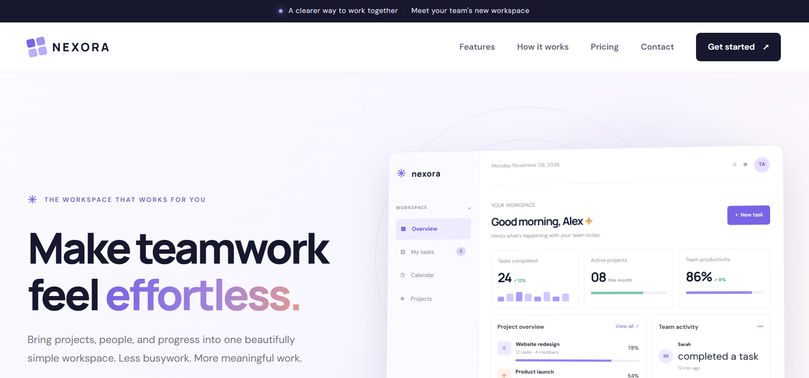
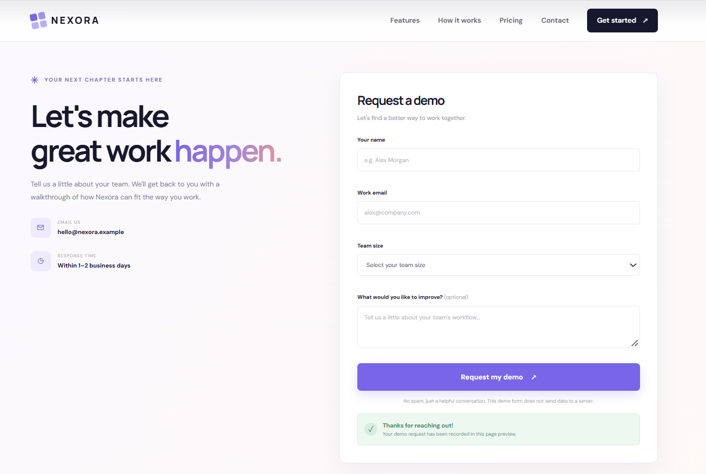
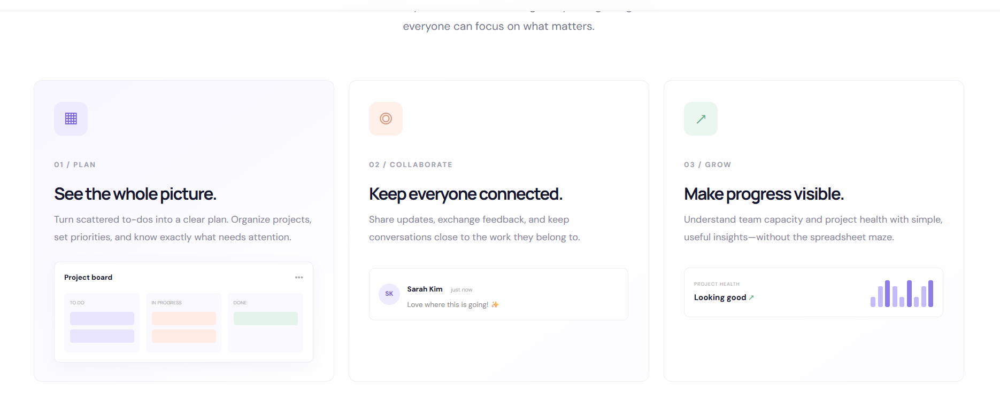
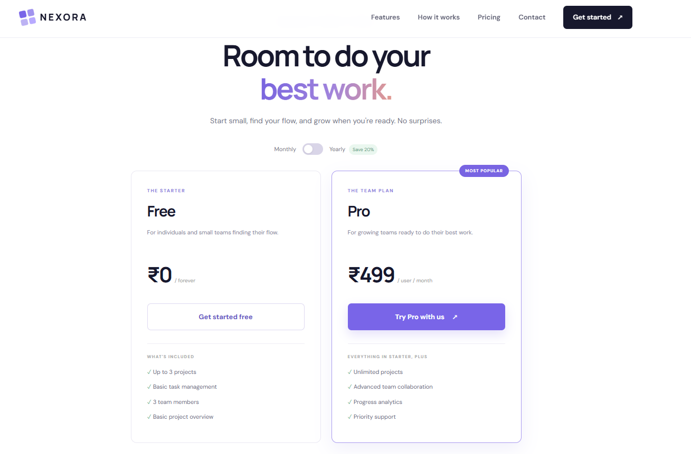
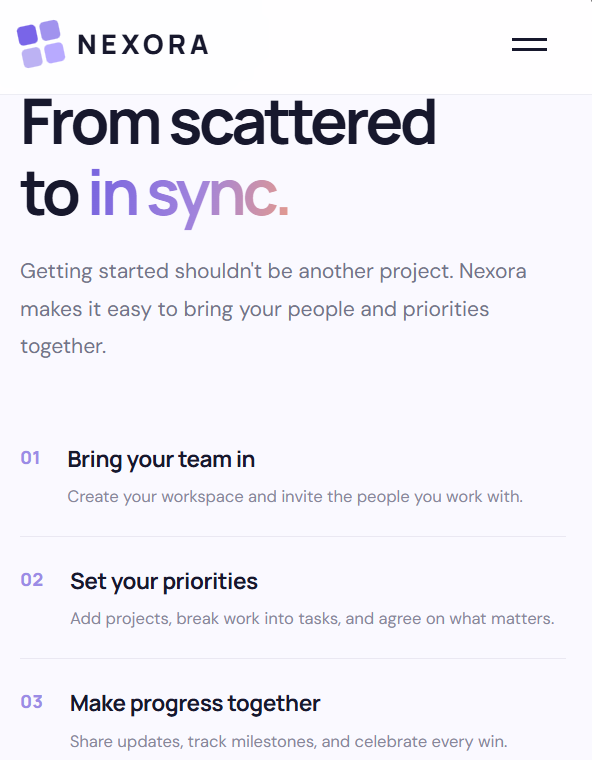
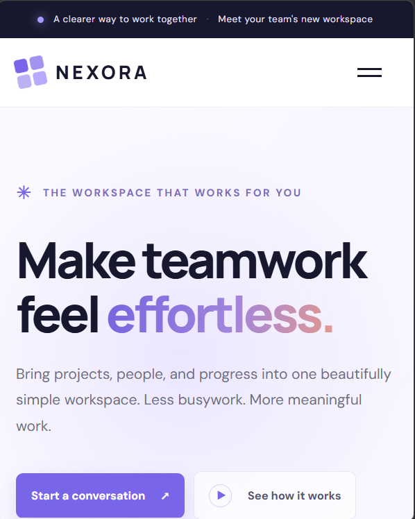

# Nexora — SaaS Landing Page

A responsive SaaS product landing page created as a Front-End Development Internship assignment.

## About the Project

Nexora is a fictional productivity and project collaboration platform. The landing page introduces the product, explains its features, presents sample pricing, and encourages visitors to request a demo.

## Features

- Responsive navigation with a mobile menu
- Hero section with a CSS-built product dashboard illustration
- Feature cards and a three-step "How It Works" section
- Starter and Pro pricing plans
- Monthly/yearly pricing toggle
- Demo request form with name, email, and team-size validation
- Success message after valid form submission
- Pricing CTA buttons prefill the selected plan in the contact form
- Reduced-motion support and semantic page sections

## Technologies Used

- HTML5
- CSS3 (Flexbox, Grid, Media Queries, Custom Properties)
- Vanilla JavaScript
- Google Fonts (Manrope and DM Sans)

## Screenshots

### Homepage


### Analtytics


### contact-form


### Features Section


### Pricing Section


### Mobile View


### Homepage mobile


## Project Structure

```text
nexora-saas-landing/
├── screenshots/
│   ├── homepage.png
│   ├── features.png
│   ├── pricing.png
│   └── mobile.png
├── index.html
├── style.css
├── script.js
└── README.md
```

## Run Locally

1. Download or clone this repository.
2. Open the project folder in VS Code.
3. Open `index.html` in your browser.

For a local development server, you can use the VS Code **Live Server** extension and select **Open with Live Server** on `index.html`.

No package installation or backend is required.

## Important Note About the Demo Form

This is a front-end-only assignment. The form validates visitor input and displays a success message in the browser. It does not transmit or store form data because no backend is included.

## Deployment

This static project can be deployed using Vercel:

1. Push the project to a GitHub repository.
2. Sign in to Vercel.
3. Choose **Add New → Project**.
4. Import the GitHub repository.
5. Select **Other** as the framework preset.
6. Leave the build command and output directory empty.
7. Click **Deploy**.

## Design Explanation

Nexora uses a calm lavender and warm-neutral color palette to make the interface feel focused and approachable. A bold headline and clear calls to action establish the product's purpose immediately.

The dashboard illustration is built with HTML and CSS, keeping the page lightweight without depending on a large image asset. Reusable cards, consistent spacing, and responsive grids maintain visual consistency across screen sizes.

JavaScript powers the mobile navigation, pricing toggle, plan selection, and form validation. The demo form displays a success state locally and clearly indicates that no backend submission takes place.

## Author

Created as a Front-End Development Internship assignment.